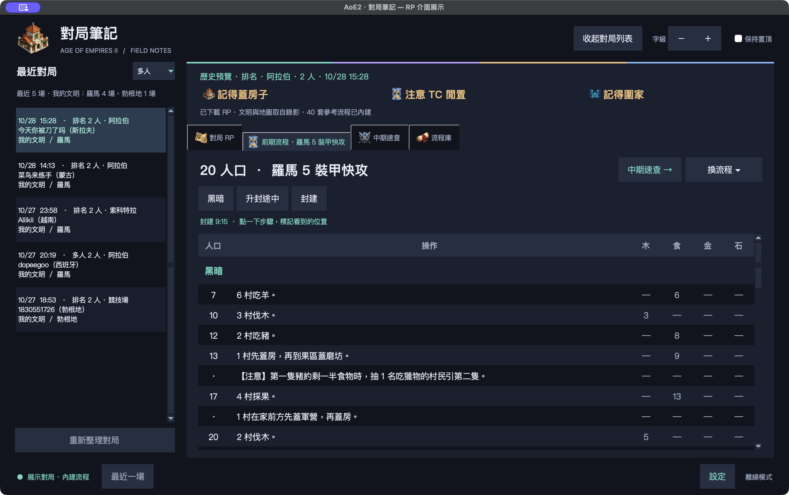
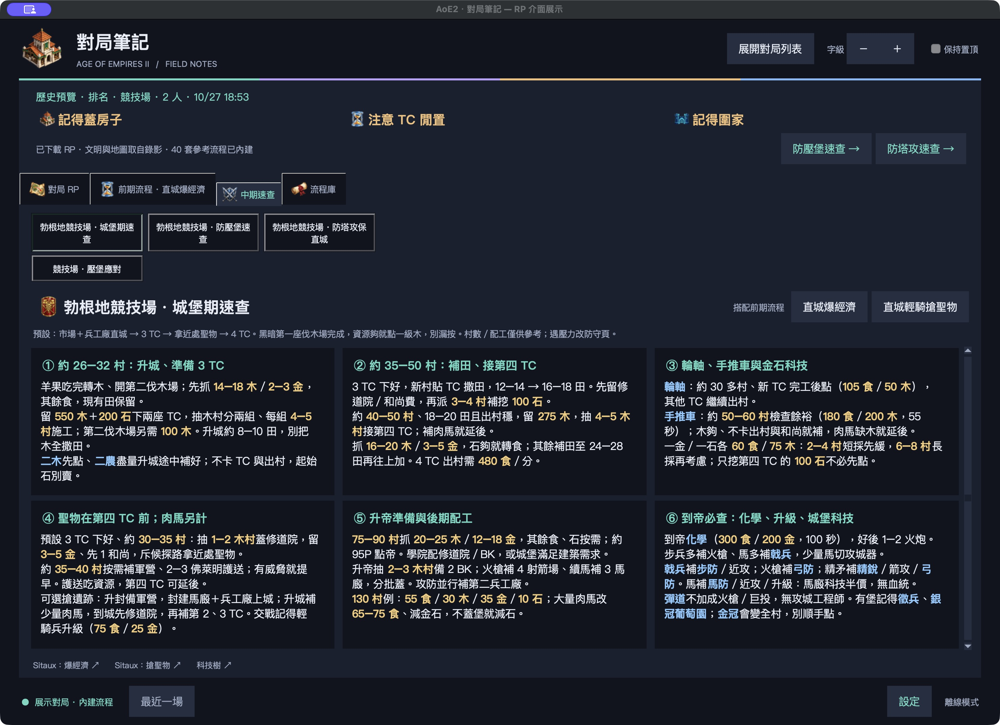

# AoE2 對局筆記

**遊戲進行中，在第二螢幕直接查看對手 Elo 與文明特性。**

從本機 RP 自動辨識對局，也能查前期流程、切換戰術提醒。適用《世紀帝國 II：決定版》。

### [下載 Windows EXE](https://github.com/HanaYukii/aoe2-tools/releases/latest/download/aoe2-opponent-dashboard.exe)

Windows 64 位元，免安裝 Python。目前以 Windows Steam 版測試。

[版本與更新說明](https://github.com/HanaYukii/aoe2-tools/releases) · [問題回報](https://github.com/HanaYukii/aoe2-tools/issues)

## 開局就看對手

自動辨識對手文明，顯示 **1v1／團戰 Elo、文明加成與特殊科技**，不用另外查網頁。Elo 為查詢當下的積分。

## 開始使用

1. 下載 EXE 並開啟，確認遊戲與錄影位置，選擇自己的玩家。
2. 開始一場有錄影的對局，工具會偵測新 RP。
3. 在「對局 RP、前期流程、中期速查、地圖注意、流程庫」切頁查看。

支援置頂、調整字級與收起對局列表；首次開啟優先使用副螢幕，之後記住視窗位置。

## 前期流程

內建 40 套中文流程，依自己的文明與地圖選擇。可隨時換流程、點步驟標記進度；新對局重新開始。

## 中期速查

用卡片整理配工、科技、轉兵與補 TC。羅馬可切換對弓兵、馬弓、騎士等分支；競技場提供對應的壓堡、防塔攻提醒。數量與時機是參考，依戰況調整。

## 文明與流程庫

- **對局 RP**：查看自己、對手與隊友的文明特性、特殊兵種應對，回顧最近 10 場。
- **地圖注意**：依本場地圖顯示開局資源、配工、防守與團戰提醒；也能選圖預習，已整理 28 張。
- **流程庫**：搜尋全部流程，調整各文明的推薦順序，查開局資源配置。
- **隨時提醒**：記得蓋房子、注意 TC 閒置、記得圍家。

流程與速查隨程式內建，換電腦不必搬教材。影片為選用的本機檔案，未附影片或 PDF。

## 資料與限制

- 文明、兵種說明讀取自己的遊戲安裝；設定與 RP 留在本機。
- 可選擇查詢目前積分，會將玩家 profile ID 傳給官方排行榜 API。
- 只讀取 RP 檔頭，不讀取遊戲記憶體；目前不提供自動復盤、實際配工、勝敗或時長分析。
- 截圖為 macOS 離線預覽，以已下載 RP 載入玩家、文明與地圖；流程與戰術卡是內建參考，不是從該場自動推導。
- 非官方社群工具，Windows EXE 尚未簽章。

[開發、離線預覽與自行打包](opponent-civ/README.md)
