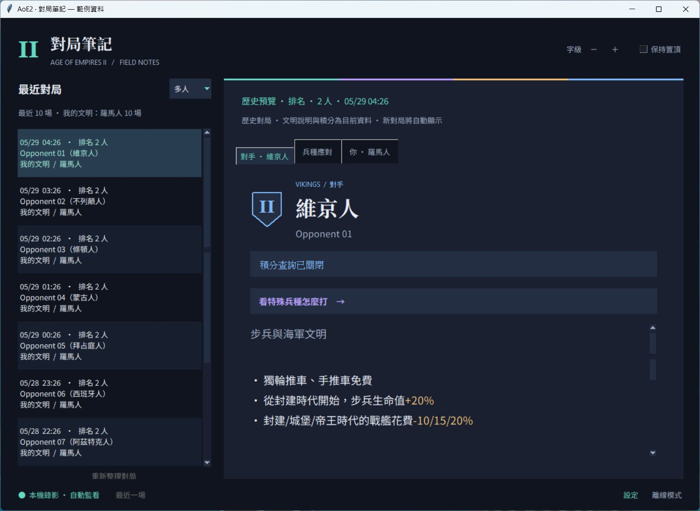
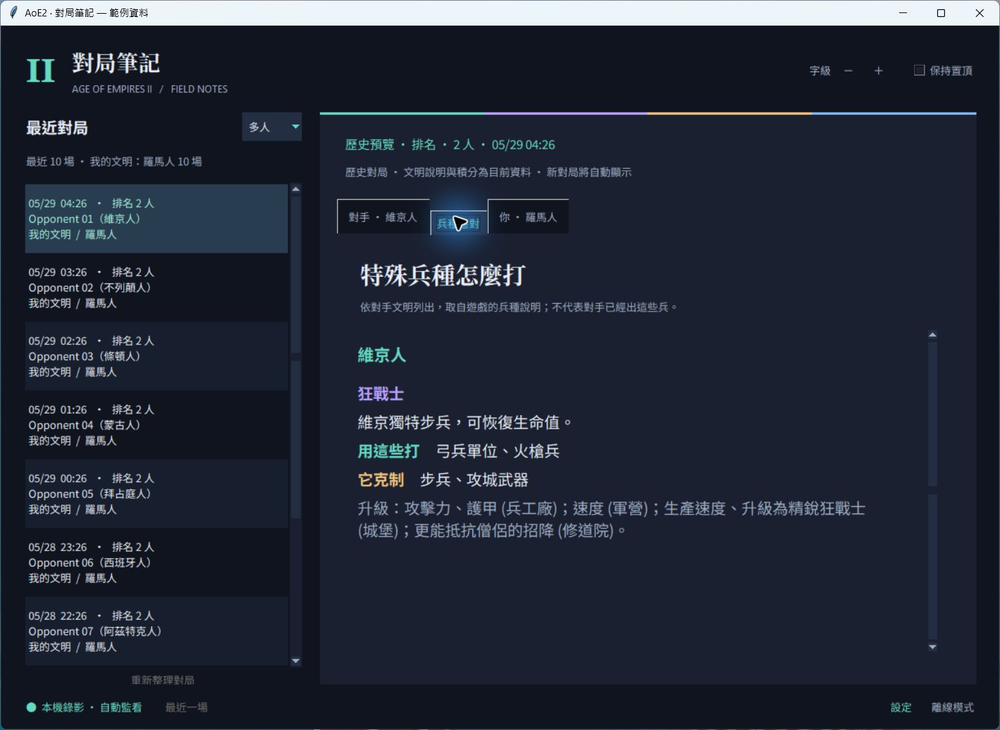

# AoE2 對局筆記

開局看對手文明、回顧最近 10 場、查特殊兵種怎麼打。適合放在第二螢幕。

## 下載

### [⬇ 下載 Windows EXE](https://github.com/HanaYukii/aoe2-tools/releases/latest/download/aoe2-opponent-dashboard.exe)

[所有版本與更新說明](https://github.com/HanaYukii/aoe2-tools/releases) · Windows 64 位元 · 免安裝 Python

需要先安裝 **Age of Empires II: Definitive Edition**。目前以 Windows Steam 版測試。

## 三步開始

1. 下載 EXE，放到常用資料夾後雙擊開啟。
2. 首次設定確認遊戲位置，從錄影偵測出的名單選「哪位玩家是你」，按「儲存並開始」。通常不必手填路徑或 ID；沒有錄影也可先使用自動判斷。
3. 開始一場有錄影的對局。工具偵測到新錄影後，會自動顯示文明資訊。

右下角「設定」可修改路徑、玩家、資料語言及積分查詢；儲存後重開生效。桌面捷徑可對 EXE 按右鍵 → 傳送到 → 桌面（建立捷徑）。

## 畫面範例

深色介面、可調字級與置頂。左側最近 10 場，右側切換對手、自己與隊友的文明。



點「看特殊兵種怎麼打」，直接跳到對手文明的兵種應對。



*截圖使用虛構玩家與範例對局。兵種應對來自遊戲說明，不代表對手實際出了這些兵。*

## 資料與限制

- 文明與兵種說明讀取使用者自己的遊戲安裝；EXE 不包含遊戲資料、個人錄影或帳號設定。
- 設定留在本機，不需要帳號密碼。積分查詢會將對局玩家的 profile ID 傳給官方排行榜 API，可在設定關閉。
- 最近 10 場來自本機錄影，可篩選多人／排名／全部；尚不包含勝敗、時長或歷史積分。顯示的是目前文明資料與目前積分。
- 只讀取錄影檔，不讀取遊戲記憶體、不注入。遊戲更新可能改變錄影格式；解析失敗時會提示。
- 本工具為非官方社群工具。EXE 尚未做程式碼簽章。

遇到問題可到 [Issues](https://github.com/HanaYukii/aoe2-tools/issues) 回報版本與錯誤訊息。

[開發、命令列與自行打包](opponent-civ/README.md)


### 參考流程

最新對局上方的「我的文明流程」會在同一視窗開啟流程選單，依自己的文明列出常用開局，並提供全庫搜尋、地圖篩選與每個文明各自的收藏。一般文明先顯示單射箭場弓兵、單馬廄斥候、直城爆經濟、通用裝甲，以及適用的文明專屬流程；特殊開局或需要調整的內容可從全部流程查找。

- 「直接看」重用同一個「流程閱讀」分頁，按「返回 RP」回到文明頁；「另開分頁」保留獨立流程頁，同一流程不重複開。
- 整張流程表依階段排列，點一列標記位置；階段按鈕只跳到該段，不隱藏其他步驟。標記、滑動位置與收藏儲存在本機設定資料夾。
- 「已開流程」可選取被其他分頁擠出畫面的流程。更新 RP 不會刪除已開的流程頁。
- 左側最近對局可收起。首次使用新版時，視窗預設佔副螢幕工作區的九成；後續保留使用者調整的大小與位置。

**參考流程、配工步驟、打法與轉型筆記隨程式內建**，開啟就能選流程，換電腦不用再搬教材或選資料夾。內容使用台灣玩家說法，人口與操作村數沿用中文版。流程選單另有「開局調整」，可查動物配置與開局原則。

附有影片連結的流程可開啟對應的教學頁面；會員影片的觀看資格由原網站處理。影片與 PDF 檔案不包含在執行檔中。有下載影片時，可選「本機影片（選用）…」，選影片所在資料夾或其上一層教材目錄；可辨識對應檔名，不需要額外準備影片清單或文字檔。選不到或找不到影片，不影響任何內建流程。舊版的教材目錄設定會沿用為選用的影片位置。

後續可持續加入不同來源或自行整理的流程，統一放在「參考流程」中。內建資料在 `opponent-civ/data/builds.zh-TW.json`，每套流程的固定 ID、人口、文明適用性、配工步驟與影片連結獨立存放。修改內容後隨新版程式一起發布；固定 ID 保留使用者的收藏與閱讀位置。PyInstaller 將資料打包進單一 EXE，打包後會從空目錄執行該 EXE，比對流程、步驟與影片連結數量，確認所有內建資料均可載入。

沒有安裝遊戲的電腦也能離線預覽介面（Python 3.12+ 且含 Tk）：

```sh
python opponent-civ/dashboard.py --demo
```

對局與文明說明是明確標示的展示資料，流程表使用完整內建資料。加上 `--demo-build 33` 可直接查看羅馬流程。Windows 的正式監看模式仍讀取遊戲資料與錄影；macOS 預覽不模擬錄影偵測或 Windows 雙螢幕 API。
