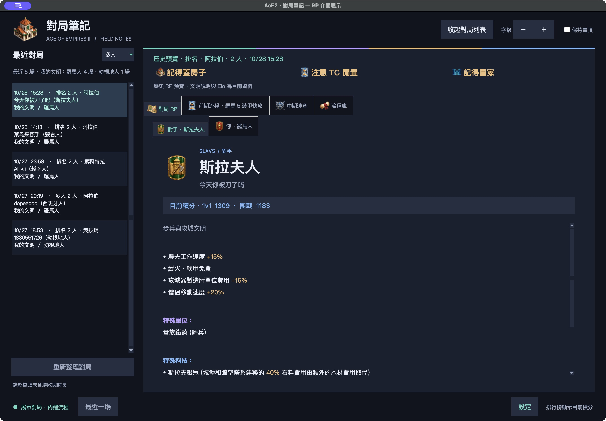
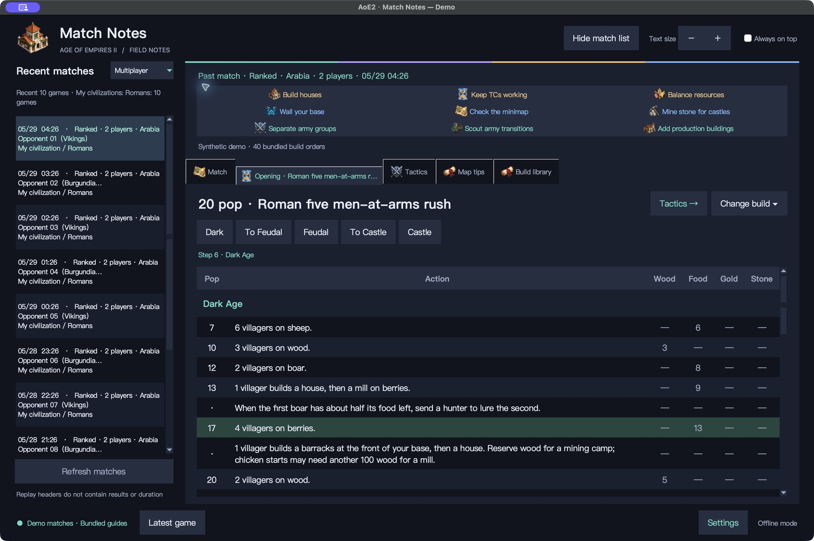
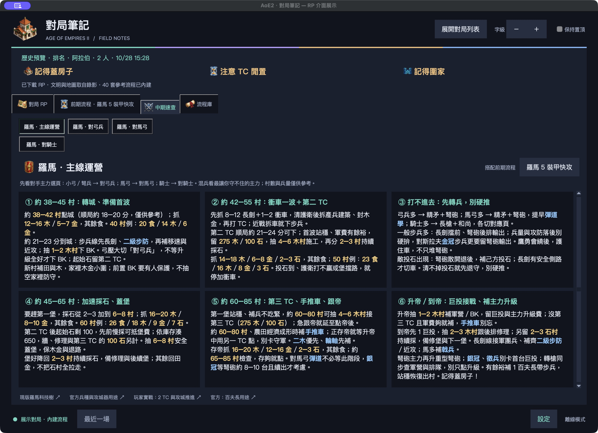

# AoE2 Match Notes

English | [繁體中文](README.zh-TW.md)

**See your opponents' Elo and civilization bonuses on a second screen while you play.**

A desktop companion for Age of Empires II: Definitive Edition. It detects matches from local replay headers and puts build orders, unit counters and tactical reminders beside the game.

### [Download for Windows](https://github.com/HanaYukii/aoe2-tools/releases/latest/download/aoe2-opponent-dashboard.exe)

Windows 64-bit. No Python installation required. Primarily tested with the Steam version of AoE2 DE.

[Release notes](https://github.com/HanaYukii/aoe2-tools/releases) · [Report an issue](https://github.com/HanaYukii/aoe2-tools/issues)

English and Traditional Chinese are included from v0.4.0.

## Know your opponent from the start

See **current 1v1 and team-game Elo, civilization bonuses and unique technologies** without opening another website. Ratings reflect the time of lookup, not the historical match rating.

## Get started

1. Open the app, confirm your game and recording folders, and select your player identity.
2. Choose `en` for English or `tw` for Traditional Chinese in Settings, then restart. Existing users keep their saved language; first-time users default to their system language where supported.
3. Start a recorded game. The app detects the new replay and displays the match.
4. Switch between **Match, Opening, Tactics, Map tips and Build library**.

The window prefers a secondary display and remembers its position. You can keep it on top, adjust text size and collapse the match list. It does not register gameplay hotkeys.

## Build orders and quick references

- **40 build orders**, recommended by civilization and map. Change builds at any time and click a step to mark your place.
- **Tactical cards** for worker allocation, upgrades, army transitions and extra TCs. Roman guides separate Feudal, Castle and Imperial play, with branches against archers, cavalry archers and knights.
- **Arena defense guides** for castle drops and tower rushes, plus a Burgundian economy reference.
- **28 map guides** covering unusual starts, food sources, fishing, defensive adjustments and team-game coordination.
- **Nine persistent reminders** for housing, TC uptime, resource balance, walls, minimap checks, stone, control groups, scouting and production capacity.

Counts and timings are practical starting points, not mandatory thresholds. Adapt to scouting, pressure and your economy.

Guides are bundled for offline use. Optional local videos/PDFs are not included or required.

## Data and limitations

- Civilization and unit descriptions come from your installed game. The app also lists unique/regional unit counters from the game's descriptions; it does **not** detect the opponent's live army.
- Settings and recordings stay local. Optional rating lookup sends player profile IDs to the official leaderboard API.
- The app reads replay headers, not game memory. It does not currently provide automatic post-game reviews, live worker allocation, match results or duration analysis.
- Screenshots show macOS previews in English and Traditional Chinese. Tactical content is bundled reference material, not analysis inferred from the displayed game.
- This is an unofficial community tool. The Windows executable is unsigned.

[Development, offline preview and packaging](opponent-civ/README.en.md)
