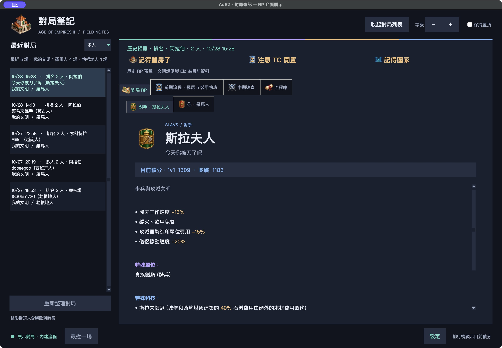
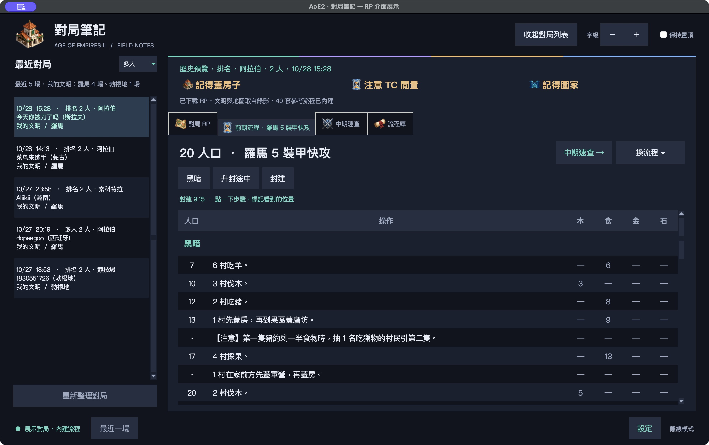
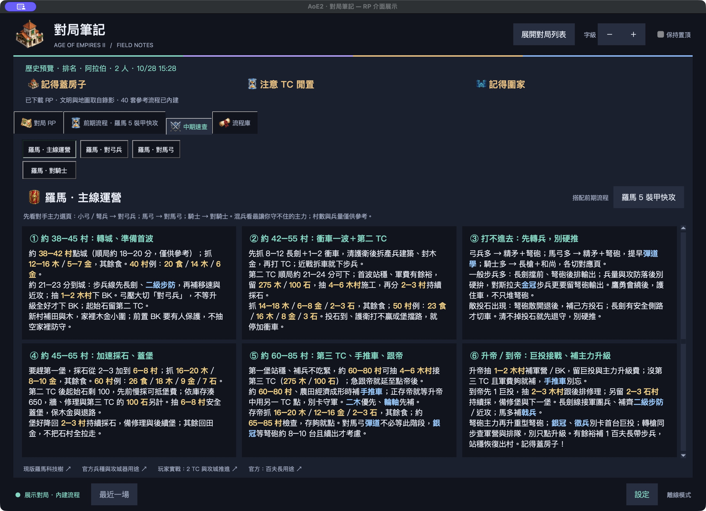
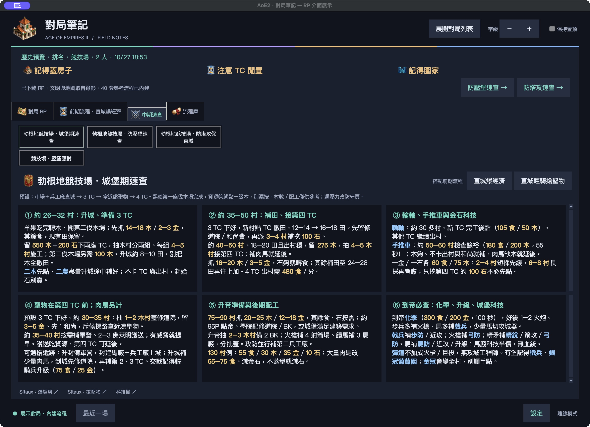

# AoE2 对局笔记

[English](README.md) | [繁體中文](README.zh-TW.md) | 简体中文

**游戏进行中，在第二屏幕直接查看对手 Elo 与文明特性。**

从本机 RP 自动辨识对局，也能查前期流程、切换战术提醒。适用《世纪帝国 II：决定版》。

### [下载 Windows EXE](https://github.com/HanaYukii/aoe2-tools/releases/latest/download/aoe2-opponent-dashboard.exe)

Windows 64 比特，免安装 Python。目前以 Windows Steam 版测试。

[版本与更新说明](https://github.com/HanaYukii/aoe2-tools/releases) · [问题回报](https://github.com/HanaYukii/aoe2-tools/issues)

## 开局就看对手

自动辨识对手文明，显示 **1v1／团战 Elo、文明加成与特殊科技**，不用另外查网页。Elo 为查找当下的积分。

## 开始使用

1. 下载 EXE 并打开，确认游戏与录像位置，选择自己的玩家。
2. 开始一场有录像的对局，工具会侦测新 RP。
3. 在「对局 RP、前期流程、战术速查、地图注意、流程库」切页查看。

在设置选 `en`、`tw` 或 `zh`（简中），重新打开后切换接口、流程与指南。既有设置保持原语言；首次启动依系统语言选择。

支持置顶、调整字级与收起对局列表；首次打开优先使用副屏幕，之后记住窗口位置。

## 前期流程

内置 40 套中英文流程，依自己的文明与地图选择。可随时换流程、点步骤标记进度；新对局重新开始。

## 战术速查

用卡片整理配工、科技、转兵与补 TC。罗马可切换对步弓手、骑射手、骑士等分支；竞技场提供对应的压堡、防塔攻提醒。数量与时机是参考，依战况调整。

## 文明与流程库

- **对局 RP**：查看自己、对手与队友的文明特性、特殊兵种应对，回顾最近 10 场。
- **团队加成**：团战时的第一个分页，我方与对手左右并排，列出每位玩家的文明、团队加成与两队平均积分；点文明可跳到该玩家。
- **地图注意**：依本场地图显示开局资源、配工、防守与团战提醒；也能选图预习，已整理 28 张。
- **流程库**：搜索全部流程，调整各文明的推荐顺序，查开局资源配置。
- **九格常驻提醒**：房子、TC 闲置、资源调配、围家、小地图、采石、分队、侦查转兵与产兵建筑。

流程与速查随程序内置，换电脑不必搬教材。视频为选用的本机文件，未附视频或 PDF。

## 数据与限制

- 文明、兵种说明读取自己的游戏安装；设置与 RP 留在本机。
- 可选择查找目前积分，会将玩家 profile ID 传给官方排行榜 API。
- 打开积分查找时，最近对局依官方对战纪录上色：胜场绿、败场红，排名赛附积分变化。本机对局先显示、颜色随后补上；查找关闭或读不到时，列表照常显示。
- 只读取 RP 档头，不读取游戏内存；目前不提供自动复盘、实际配工或时长分析。
- 截屏为 macOS 脱机预览，以已下载 RP 加载玩家、文明与地图；流程与战术卡是内置参考，不是从该场自动推导。
- 非官方社群工具，Windows EXE 尚未签章。

[开发、脱机预览与自行打包](opponent-civ/README.md)
